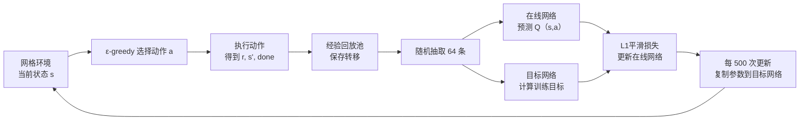

# DQN 强化学习案例：网格寻路

这个案例让智能体从左上角出发，避开深色障碍，走到右下角目标。它是一个**独立的 PyTorch 教学案例**，不依赖相邻目录中的 Atari Q-learning 脚本和模型文件。

## 运行

以下命令在 `dqn_gridworld/` 目录执行。

需要 Python 3.9+，以及 `torch`、`numpy`、`matplotlib`、`Pillow`：

```bash
python3 -m pip install torch numpy matplotlib pillow
python3 dqn_gridworld.py
```

训练默认 500 回合，图片与模型保存在 `dqn_output/`。运行后打开：

- `dqn_output/training.png`：每回合奖励、最近 30 回合成功率、探索概率。
- `dqn_output/demo.gif`：训练后的智能体逐步寻路动画。
- `dqn_output/route.png`：最终路线静态图。
- `dqn_output/dqn_model.pt`：训练得到的网络参数。


可用 `python3 dqn_gridworld.py --episodes 600 --seed 7 --output my_run` 调整回合数、随机种子和输出位置。DQN 训练有随机性；如果最后一回合贪心演示未到达目标，可增加回合数或更换种子。

## 任务与算法

环境是 32 × 32 固定地图，有五道缺口左右交替的横墙。状态由两个归一化坐标、四个方向到目标的最短距离变化、四个方向的可通行性组成，共 10 维；动作有上、下、左、右四种。到达目标奖励 `+10`；合法移动每步扣 `0.01`，距离目标每缩短一步再加 `1`、每增加一步扣 `1`；撞墙或越界奖励 `-1.2`。到达目标或走满 256 步时回合结束。

训练前用广度优先搜索计算地图中各位置到目标的实际最短距离，既用于奖励反馈，也用于构造状态特征和训练起点。训练最初从目标附近出发，逐渐扩大起点到目标的距离；最后 35% 的回合固定从左上角起点出发。评估始终从左上角出发。这个案例用已知地图的距离信息辅助 DQN 学习，适合演示探索率、经验回放和目标网络；它不演示在未知地图中自行发现路线。



核心更新目标是

`y = r + γ(1 - done) max_a' Q_target(s', a')`

其中 `γ = 0.99`。在线网络输出四个动作的 Q 值；目标网络定期同步，减少训练目标的快速波动。经验回放随机抽样，减弱连续轨迹的相关性。`ε` 按训练进度从 1 线性降到 0.1，并在最后 20% 的回合保持 0.1。演示阶段使用 `ε = 0`，即始终选择预测 Q 值最大的动作。

图中浅蓝线是单回合奖励，深蓝线是 30 回合移动平均；绿色曲线接近 1，表示近期大部分回合能到达目标。若要处理 Atari 图像，需要把状态输入和网络改为图像预处理与卷积网络，并使用更多训练步数。
